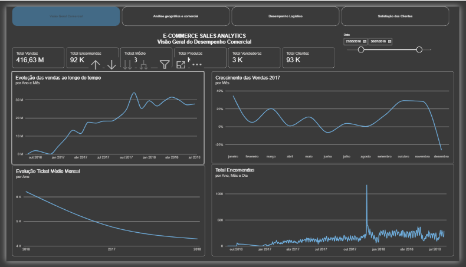
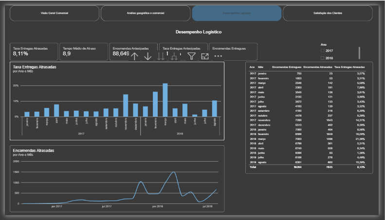
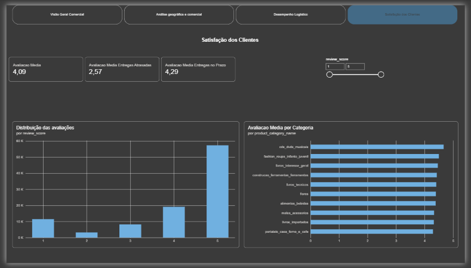

# Projeto de Análise de E-commerce

Projeto de análise de dados de e-commerce que integra preparação e
tratamento de dados com Python, armazenamento e consultas SQL e análise
de negócio através de dashboards interativos no Power BI.

## Objetivos

-   Analisar o desempenho comercial do negócio.
-   Identificar a distribuição geográfica das vendas.
-   Acompanhar a evolução das vendas e o ticket médio.
-   Avaliar o desempenho logístico e os prazos de entrega.
-   Analisar a satisfação dos clientes.
-   Construir indicadores que apoiem a tomada de decisão.

## Tecnologias

-   **Python:** exploração, preparação e tratamento dos dados.
-   **SQL / SQLite:** armazenamento, consulta e organização dos dados.
-   **Power BI:** modelação e visualização interativa.
-   **DAX:** criação de indicadores e métricas.
-   **Pandas:** manipulação e análise de dados.
-   **Matplotlib e Seaborn:** visualização e análise exploratória.

## Estrutura do projeto

``` text
Projeto_Ecommerce/
├── sql/                         # Scripts SQL
├── dados_csv/                   # Ficheiros de dados
├── python/                      # Scripts Python
├── powerbi/                     # Relatório Power BI (.pbix)
├── documentacao_tecnica/
│   └── DAX/                     # Documentação das medidas DAX
├── evidencias/                  # Imagens dos dashboards
├── relatorios/
│   ├── tabelas_tratadas_python/ # Tabelas tratadas em Python
│   └── relatorio_final/         # Relatório final
├── database/                    # Base de dados e ficheiros associados
└── README.md
```

## Dashboards

O relatório Power BI está organizado em quatro páginas principais.

### 1. Visão Geral Comercial

Apresenta os principais indicadores do negócio, incluindo vendas,
encomendas, clientes, vendedores, produtos e ticket médio.



### 2. Análise Geográfica e Comercial

Permite analisar a distribuição geográfica das vendas e comparar o
desempenho por estado, vendedor e categoria de produto.


### 3. Desempenho Logístico

Avalia o cumprimento dos prazos de entrega, distinguindo encomendas
atrasadas, antecipadas e entregues, bem como o tempo médio de atraso.



### 4. Satisfação dos Clientes

Analisa as avaliações dos clientes e a relação observada entre o prazo
de entrega e a classificação atribuída.



## Indicadores desenvolvidos

-   Total de vendas e total de encomendas.
-   Ticket médio.
-   Total de clientes, vendedores e produtos.
-   Crescimento mensal das vendas (MoM).
-   Encomendas entregues, atrasadas e antecipadas.
-   Taxas de entregas atrasadas e antecipadas.
-   Tempo médio de atraso.
-   Avaliação média dos clientes.
-   Avaliação média das entregas atrasadas e das entregas no prazo.

As expressões e descrições das medidas DAX estão documentadas em
`documentacao_tecnica/DAX`.

## Principais conclusões

A análise integrou as perspetivas comercial, geográfica, logística e de
satisfação dos clientes. Foram observadas diferenças de desempenho entre
estados, vendedores e categorias de produto. Os resultados também
evidenciaram a relevância do acompanhamento dos atrasos logísticos.

As avaliações médias das encomendas entregues com atraso foram
inferiores às avaliações das encomendas entregues no prazo ou
antecipadamente. Esta é uma associação observada nos dados e,
isoladamente, não demonstra causalidade.

Os valores detalhados, a metodologia, as interpretações e as limitações
encontram-se no relatório final guardado em
`relatorios/relatorio_final`.

## Metodologia

1.  Recolha e conhecimento dos dados.
2.  Exploração inicial das tabelas.
3.  Tratamento e preparação dos dados com Python.
4.  Organização e consulta dos dados em SQL.
5.  Modelação e criação de relacionamentos no Power BI.
6.  Criação de medidas DAX e indicadores.
7.  Construção dos dashboards.
8.  Análise, validação e documentação dos resultados.

## Como explorar o projeto

1.  Consulte `sql/` para os scripts SQL.
2.  Consulte `python/` para os scripts de preparação e análise.
3.  Abra o ficheiro `.pbix` em `powerbi/` com o Power BI Desktop.
4.  Consulte `documentacao_tecnica/DAX/` para as medidas.
5.  Consulte `relatorios/relatorio_final/` para o relatório completo.

## Nota sobre os dados

Antes de publicar o repositório, confirme que os ficheiros podem ser
partilhados e que não contêm dados pessoais, credenciais, ligações
privadas ou informação confidencial. Se necessário, publique apenas
dados de demonstração anonimizados ou os scripts de preparação.

------------------------------------------------------------------------

**Projeto desenvolvido para fins de aprendizagem, análise de dados e
demonstração de competências em Python, SQL e Power BI.**
